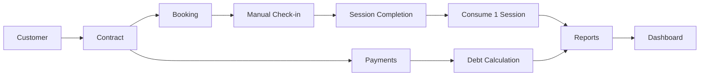

# 00 — Project Overview

## 1. Purpose

Fitness CRM is an internal management system for one gym. It replaces fragmented manual tracking with one workflow for customer information, contracts, PT/session operations, payments, debt, reporting, and management dashboards.

## 2. Primary users

- Admin
- Manager
- Receptionist
- Trainer / PT
- Accountant

## 3. Core business outcome

The system must answer these questions reliably:

- Who is the customer?
- Which contracts belong to that customer?
- How many sessions were purchased, completed, and remaining?
- What is booked today and with which PT?
- Which sessions were actually completed?
- How much has each contract paid and still owes?
- What is the gym's operational and financial performance?

## 4. End-to-end CRM flow

## 5. Product philosophy

- Keep V1 small and operationally useful.
- Prefer data integrity over feature breadth.
- Treat money and session consumption as critical domains.
- Avoid premature SaaS/multi-branch complexity.
- Add integrations only after core data and workflows are stable.
