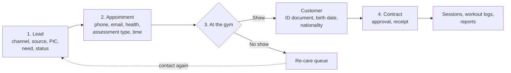
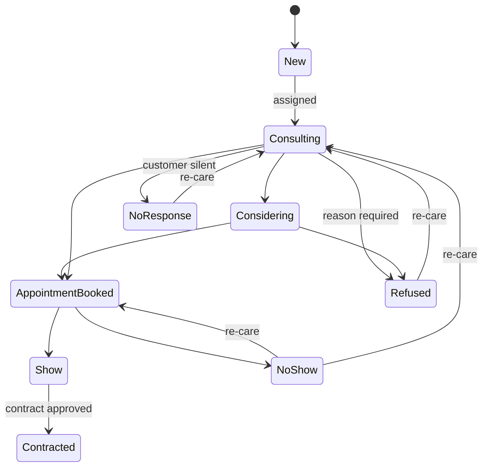
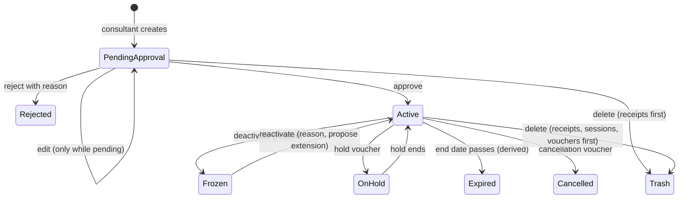
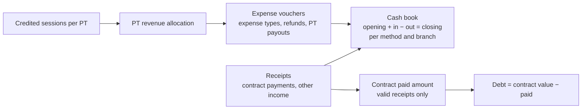
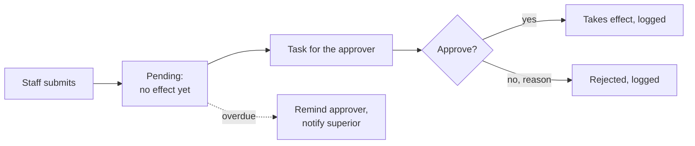

# 02 — Business Flow

Flows are fixed in code; the values inside them (timers, lists, rules, colors) are configuration (D-015).

## Flow 1 — Customer journey (brief §3)

One person has **one record** throughout: the Lead ID becomes the Customer ID at Show (D-019).

| Stage | What happens | Data added | Who |
|---|---|---|---|
| 1. Lead | Arrives from a digital channel, walk-in, or partner; tagged with channel; assigned to a consultant; manager notified; consultant follows the journey | Lead code, channel, source, PIC, name, need, status | System, Consulting |
| 2. Appointment | Consulting succeeds; the customer books a visit | Phone, email, basic health, assessment type, date and time, note | Consulting, Receptionist |
| 3. At the gym | Reception marks Show or No show; Show converts to customer; No show returns to re-care | Customer ID, ID card/passport, birth date, nationality | Receptionist, Consulting |
| 4. Contract and after | Contract created, approved, paid; PT books and logs sessions; reports | Branch, service, payment, promotion, schedule, sessions | Consulting, Manager, PT, Admin |

Duplicate phone numbers warn and offer a merge. A customer who showed without signing stays a customer and is followed up.

## Flow 2 — Lead statuses (brief §3, D-020)

Refused, No response, and No show are never closed; they wait in the re-care queue with a contact-again date. Statuses Consulting, Considering, No response, Appointment booked, and Refused match the "Booking Status" column of the consulting Excel. Every change stores who and when.

## Flow 3 — Consulting checklist (brief §4.1, D-020)

Each lead gets a checklist. The system creates a task with a deadline for the person in charge and records who completed each step and when. Results are drop-downs. Timers and steps are configuration; changes apply to new leads only.

| Step | Task created when | Result (initial options) |
|---|---|---|
| 1. Recommend the right product | As soon as the lead is assigned | Need group, need detail, pain status, assessment type; "Done" |
| 2. Reminder 1 | 60 min after no reply | Done |
| 3. Reminder 2 | 24 h after no reply | Done |
| 4. Book the visit | When the customer agrees | Date and time; status → Appointment booked |
| 5. Pre-visit reminder 1 | 3 h before the visit | Confirmed / No reply |
| 6. Notify Studio 1 | Right after step 5 | Task for the coach manager (Tasks module) |
| 7. Pre-visit reminder 2 | 60 min before the visit | Confirmed / No reply |
| 8. Notify Studio 2 | Right after step 7 | Updates the coach manager's task |
| 9. Record Show / No show | At the visit time | Show converts to customer |
| 10. Re-care | 15 days later for No response, Refused, No show | Booked / Refused, then Show / No show |

Assessment suggestion for consultants (initial values): a customer training 3 weeks (20 sessions) or more gets a free Fitness Assessment; less than 20 days gets 50% off.

## Flow 4 — Contract lifecycle (brief §5, D-021–D-024)

- Price comes from the service's tier for the session count; an exception price needs a reason and approval (D-021).
- An approved contract is locked, even for admin. Changes go through change vouchers: renewal, upgrade, hold, transfer, branch transfer, conversion, cancellation (D-024).
- A frozen contract cannot be booked, checked in, or burned and does not expire; reactivation proposes adding the frozen days (D-023).

## Flow 5 — Sessions (brief §6, D-025–D-028)

| Action | When | Status after | Consumes a session | Credits the PT | Color (initial) |
|---|---|---|---|---|---|
| Create booking | Booked, not yet held | Booked | No | No | Red |
| Đã tập | The session took place (admin, phase 1) | Đã tập (locked) | Yes | Yes | Blue |
| Hủy lịch | Customer cancelled in advance | Hủy lịch | No | No | Purple |
| Khách không đến | Booked but did not come | No-show | Yes | Yes | Yellow |
| Xóa | Booked at the wrong time | Leaves the grid, in trash | No | No | Hidden |
| Burn Show | Admin adds a session by hand (with reason) | Đã tập, "added by hand" | Yes | Yes | Blue |
| Delete from check-in history | Fraud or wrong check-in (with reason) | In trash | Refunds 1 | Removes the credit | — |

Each session stores the rule it was given (T-050). Every change in the customer's session count sends an email (D-036). A deletion in a period already paid to the PT adds an adjustment to the next period (D-027).

## Flow 6 — Money (brief §8.1, D-032, D-034)

- Collecting money on a contract always creates a receipt; paid, debt, and payment status come only from valid receipts (approved, not deleted).
- A refund on cancellation is an expense voucher linked to the contract.
- PT payouts are expense vouchers created from the PT revenue allocation of a period, storing the period and sessions so nothing is paid twice.

## Flow 7 — Approvals (brief §2, D-018)

Nobody approves their own submission. The initial approval matrix is in `09_RBAC.md`.
