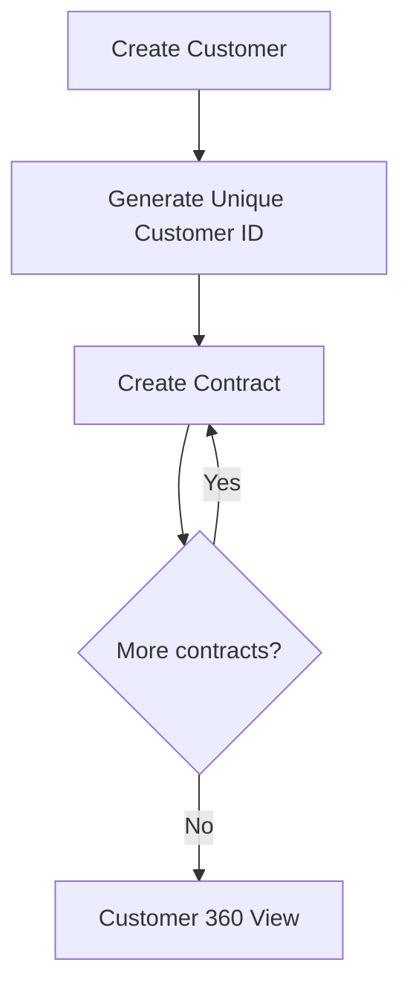
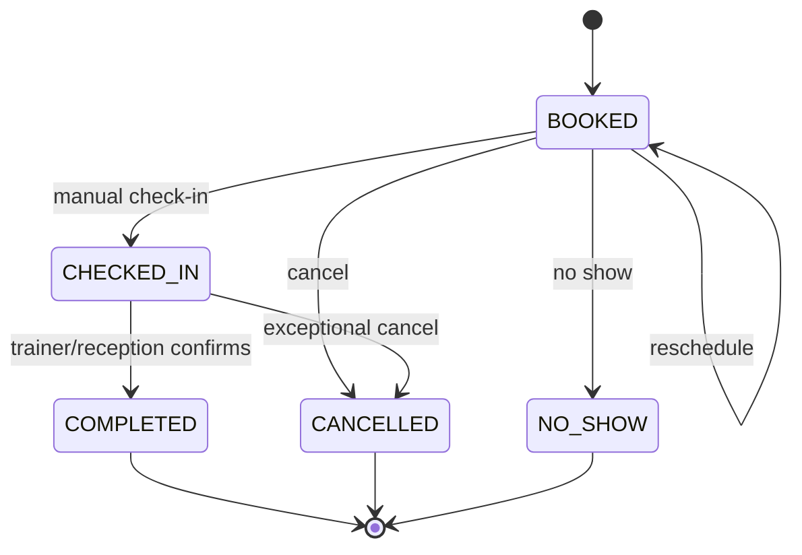
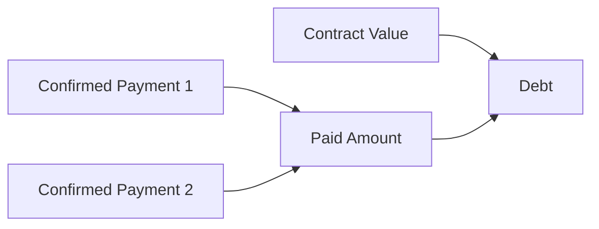
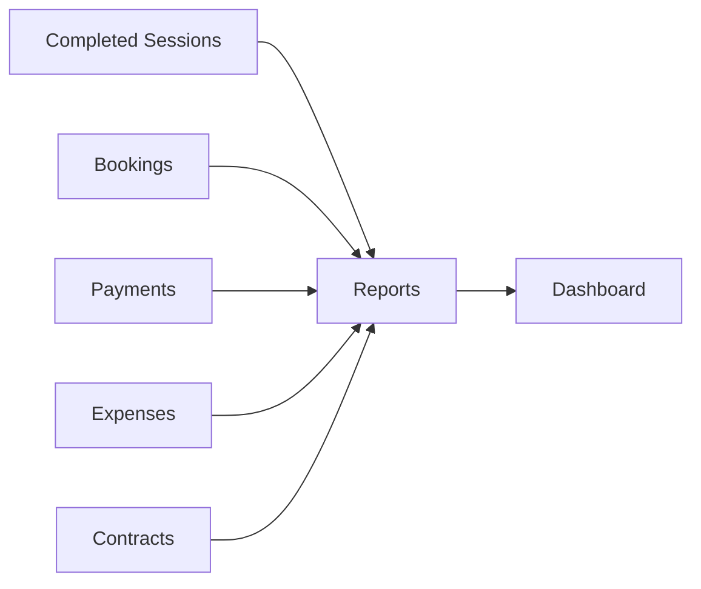

# 02 — Business Flow

## Flow 1 — Customer and contracts



### Example

Customer `KH000123` can have:

- `HD000001` — PT 24 sessions
- `HD000002` — PT 12 sessions
- `HD000003` — another package later

The customer ID identifies the person. Contract IDs identify separate commercial agreements. Code formats are A-003.

## Flow 2 — Booking lifecycle and session consumption

The status belongs to the booking (T-011). A session record is created at check-in and stores who checked in and completed the session, and when.



Actions are allowed only from the statuses shown (A-006). Completion directly from `BOOKED` is open (OQ-002).

### Consumption rule

Only `COMPLETED` consumes one session.

Example:

- Purchased: 24
- Completed before today: 8
- Today's booking created: remaining still 16
- Check-in: remaining still 16
- Complete today's session: remaining becomes 15

## Flow 3 — Finance and debt



Formula:

```text
paid_amount = opening_paid_amount + SUM(confirmed contract payments)
debt = contract_value - paid_amount
```

## Flow 4 — Reporting

Operational and finance data feed management reporting:


