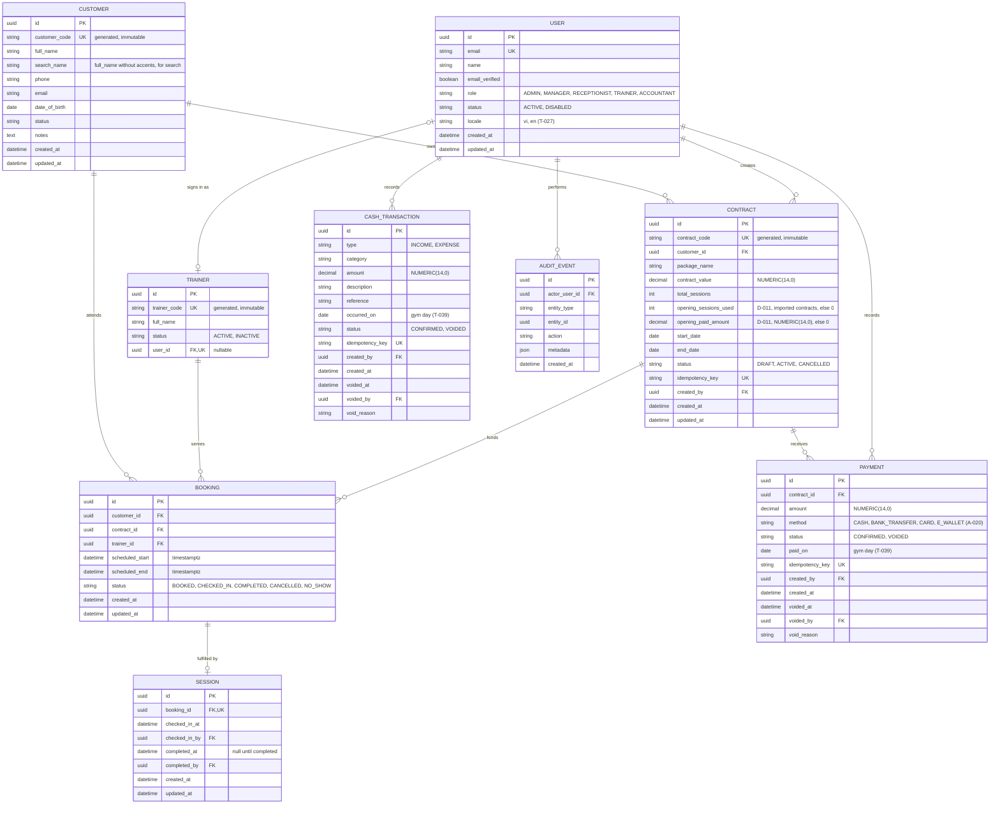

# 04 — Data Model & ERD

## Proposed ERD



Better Auth (T-028) also owns `auth_sessions`, `auth_accounts` (which holds the password hash), `auth_verifications`, and `auth_rate_limits`. They are omitted from the diagram; `prisma/schema.prisma` is the full definition.

## Source-of-truth rules

### Booking status and sessions

The booking's `status` is the only lifecycle status (T-011). A session record is created at check-in and stores who checked in and completed, and when. It has no status of its own.

### Remaining sessions

```text
completed_sessions = COUNT(booking WHERE booking.contract_id = contract.id AND booking.status = 'COMPLETED')
remaining_sessions = contract.total_sessions - contract.opening_sessions_used - completed_sessions
```

`opening_sessions_used` and `opening_paid_amount` are 0 for contracts created in this system. For contracts imported at go-live they hold what happened before go-live (D-011); they are set once, audited, and never edited.

Only the booking status is counted (T-012). `session.completed_at` records when and by whom, but is not a second source of truth.

Do not let the frontend submit a trusted remaining-session number.

### Debt

```text
paid_amount = contract.opening_paid_amount + SUM(payment.amount WHERE payment.status = CONFIRMED)
debt = contract.contract_value - paid_amount
```

### Contract status

The stored status is `DRAFT`, `ACTIVE`, or `CANCELLED`. A contract is reported as `EXPIRED` when its stored status is `ACTIVE` and `end_date` is before today in the gym timezone (T-018, A-001).

### Booking references

A booking's `customer_id` must equal its contract's `customer_id` until OQ-010 is answered. The service validates this.

### Booking / session uniqueness

A booking produces at most one session record, enforced by the unique `session.booking_id`.

### Numeric precision

Use fixed decimal types for money. Do not use floating point for currency (T-023). Money columns are `NUMERIC(14,0)` under A-002.

### Time

All datetime columns are `timestamptz` (Prisma `@db.Timestamptz(3)`) and store UTC. Display uses the gym timezone (A-001).

## Database-enforced constraints

These constraints must exist in the database, not only in service code, because concurrent requests can pass a service-level check at the same time.

| Constraint | Rule |
|---|---|
| Unique `customer.customer_code`, `contract.contract_code`, `trainer.trainer_code` | BR-001, T-019. Codes come from the `customer_code_seq`, `contract_code_seq`, and `trainer_code_seq` sequences (customized migrations) |
| Unique `user.email`, `trainer.user_id` | A-010 |
| Unique `session.booking_id` | one session per booking |
| Unique `contract.idempotency_key`, `payment.idempotency_key`, `cash_transaction.idempotency_key` | T-015 |
| Check `contract.total_sessions > 0`, `0 <= opening_sessions_used <= total_sessions`, money not negative, `end_date >= start_date` | Contract sanity; contract codes come from `contract_code_seq` |
| Check `booking.scheduled_end > booking.scheduled_start` | BR-011 |
| Check `session.completed_at` and `session.completed_by` are set together | Completion facts are recorded together |
| Check `payment.amount > 0` | BR-014 |
| Check `cash_transaction.amount > 0` (`type` carries the direction) | — |
| Check a `VOIDED` payment or cash transaction has `voided_at`, `voided_by`, and `void_reason`, and a `CONFIRMED` one has none | A-008, A-009 |
| Exclusion: no overlapping active bookings per trainer | BR-010, T-014 |

Trainer overlap exclusion constraint, as in migration `20261010013008_bookings`:

```sql
CREATE EXTENSION IF NOT EXISTS btree_gist;

ALTER TABLE "bookings" ADD CONSTRAINT "booking_trainer_no_overlap"
  EXCLUDE USING gist (
    "trainer_id" WITH =,
    tstzrange("scheduled_start", "scheduled_end", '[)') WITH &&
  )
  WHERE ("status" IN ('BOOKED', 'CHECKED_IN', 'COMPLETED'));
```

- `[)` makes back-to-back bookings legal (A-004). The `WHERE` clause applies the A-005 definition of active.
- `scheduled_start` and `scheduled_end` must be `timestamptz`. `tstzrange` over plain `timestamp` columns is not immutable and PostgreSQL rejects the constraint.
- Prisma does not model exclusion constraints. Add it by editing the SQL of a migration created with `prisma migrate dev --create-only`. An integration test must assert that the constraint exists (see `13_TEST_STRATEGY.md`).
