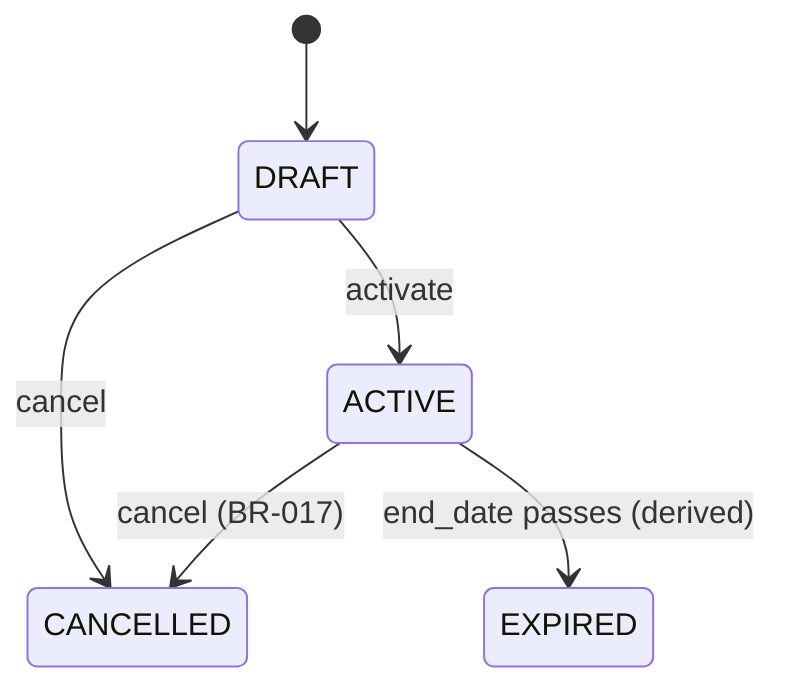

# 05 — Business Rules

## BR-001 — Customer identity

Each customer must have one unique immutable business customer ID.

## BR-002 — Multiple contracts

A customer may have zero, one, or many contracts.

## BR-003 — Contract required for session-based booking

A session-based booking must reference a contract that is `ACTIVE`, not expired (T-018), and has remaining sessions.

Whether bookings that are already open count against remaining sessions is open (OQ-008).

## BR-004 — Booking does not consume

Creating or rescheduling a booking does not change the consumed-session count.

## BR-005 — Check-in does not consume

Manual check-in does not change the consumed-session count.

## BR-006 — Completion consumes exactly one

Transitioning a session to `COMPLETED` consumes exactly one session from the referenced contract.

## BR-007 — Completion is idempotent

Submitting completion twice for the same session must not consume twice. This holds for repeated requests and for concurrent requests.

## BR-008 — Cancel/no-show behavior

In V1, `CANCELLED` and `NO_SHOW` do not consume sessions.

## BR-009 — Remaining sessions cannot go below zero

Completion must fail if the referenced contract has no remaining sessions. This holds when several sessions of the same contract are completed at the same time (see `22_TECHNICAL_ARCHITECTURE.md` §7).

## BR-010 — Booking conflict

One trainer cannot have overlapping active bookings.

- Active means `BOOKED`, `CHECKED_IN`, or `COMPLETED` (A-005).
- Time ranges are half-open, so back-to-back bookings do not overlap (A-004).
- The rule is enforced by the database, so it holds for concurrent requests (T-014).

## BR-011 — Time validity

`scheduled_end` must be later than `scheduled_start`.

## BR-012 — Contract validity

A booking date should normally fall within the contract's effective period. Exceptions require an explicit business decision (OQ-001).

## BR-013 — Debt is derived

Debt is not manually editable.

```text
debt = contract_value - opening_paid_amount - confirmed_payments
```

`opening_paid_amount` is non-zero only for contracts imported at go-live (BR-018).

## BR-014 — Payment validation

A payment amount must be greater than zero. Voided/cancelled payments do not count toward paid amount.

## BR-015 — Auditability

Critical changes to money, contracts, and session completion must be auditable.

## BR-016 — Authorization

Users may only execute operations permitted by their assigned role.

## BR-017 — Cancelling a contract cancels its future bookings

Cancelling a contract also cancels all of its `BOOKED` bookings in the same transaction, each with an audit event. Cancellation is refused while any of its bookings is `CHECKED_IN`. The confirmation lists the bookings that will be cancelled (D-010). Whether a cancelled contract still owes its debt is open (OQ-013).

## BR-018 — Opening balances for imported contracts

A contract imported at go-live records the sessions used and the amount paid before go-live. Both are set once at import, audited, and never edited, and they count in remaining sessions and paid amount. Period reports exclude them (D-011).

## Contract status proposal



`EXPIRED` is derived, not stored: a contract is expired when its stored status is `ACTIVE` and `end_date` is before today in the gym timezone (T-018).

V1 should keep contract states simple unless gym operations require freeze/transfer/upgrade.
