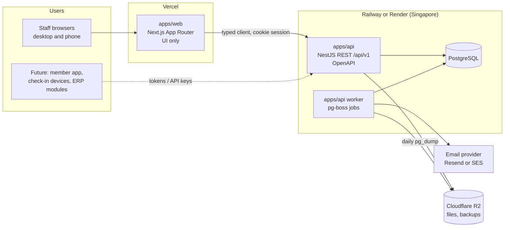

# 26 — Technical Proposal

This is the "đề xuất công nghệ và sơ đồ kiến trúc" the brief asks the developer to send before starting (brief §12). It follows the brief's requirements (§11): a documented API separate from the UI that future ERP modules, a member app, and check-in devices can share; popular, low-cost technology that is easy to hand over; staging and production; daily backups with restore tests; owner-owned code and accounts. Decisions: T-041 to T-052 in `18_DECISIONS_ASSUMPTIONS.md`.

## 1. Architecture



- **`apps/web`** renders screens and calls the API. It holds no business rules and never touches the database.
- **`apps/api`** owns authentication, authorization, business rules, data access, files, and the OpenAPI contract.
- **The worker** is the same codebase started in worker mode. It runs timers and reminders, the email outbox, notifications, and the daily backup copy. The job queue is pg-boss, stored in PostgreSQL, so there is no Redis.

## 2. Stack

| Concern | Choice | Why |
|---|---|---|
| Language | TypeScript (strict) everywhere | One language for web, API, and shared schemas; easy to hire for. |
| Monorepo | pnpm workspaces + Turborepo | Fast installs and cached builds; standard for TypeScript monorepos. |
| Web | Next.js (App Router), shadcn/ui, Tailwind, next-intl (vi, en), TanStack Table, react-hook-form + Zod | Already built and tested in Phases 0–4 (T-002, T-025–T-027). |
| API | NestJS 11 (Express adapter), `@nestjs/swagger` for OpenAPI, class-free Zod validation via `nestjs-zod` | Most popular Node API framework; modules match the brief's modules; easy handover. |
| Database | PostgreSQL 17, Prisma 7 | Already in use (T-004, T-005); `btree_gist` exclusion constraints for overlaps (T-014). |
| Auth | Better Auth inside the API (T-044) | Keeps existing users and password hashes; supports sessions, rate limits, and two-factor (TS-004). |
| Jobs | pg-boss (T-045) | Durable timers and retries in PostgreSQL; no extra service. |
| Email | Resend (recommended) or Amazon SES (T-051) | Resend is simplest; SES is cheapest at volume. Both support SPF, DKIM, and DMARC on Flow's domain. |
| Files | Cloudflare R2 (S3 API), private, signed URLs (T-052) | No egress fees; generous free tier. |
| Excel export | exceljs in the API | Column order can match GymMaster's files (brief §6.5). |
| Errors and monitoring | Sentry (free tier) for web and API; platform logs | Quick diagnosis; security events stay JSON lines (doc 24). |
| Tests | Vitest (unit, integration against PostgreSQL), Playwright (E2E), OWASP security suite | Already in place (T-007, T-021). |
| CI | GitHub Actions in the owner's repository | Lint, type-check, tests, migrations, E2E, dependency gate on every pull request. |

## 3. Repository layout

```text
fitness-crm/
├── apps/
│   ├── web/                 # Next.js: screens, components, i18n messages
│   │   ├── src/app/         # routes per module
│   │   ├── src/components/  # shadcn/ui + shared components (doc 23 §8)
│   │   └── src/lib/api/     # generated OpenAPI client
│   └── api/                 # NestJS
│       ├── src/modules/     # one Nest module per brief module (below)
│       ├── src/platform/    # auth, permissions, branches, approvals, audit, trash, config, jobs
│       ├── prisma/          # schema and migrations
│       └── test/            # integration tests against PostgreSQL
├── packages/
│   ├── shared/              # Zod schemas, DTO types, permission keys, constants
│   └── config/              # eslint, tsconfig, prettier presets
├── e2e/                     # Playwright against web + API
├── docs/
└── turbo.json, pnpm-workspace.yaml
```

API modules: `leads`, `consulting`, `customers`, `services` (tiers, promotions), `contracts`, `contract-changes`, `schedule` (PT bookings, sessions, working schedules), `classes`, `workouts` (catalogs, templates, plans, logs), `cashbook` (receipts, expense vouchers, payouts), `tasks`, `mail`, `employees`, `reports`. Platform: `auth`, `permissions`, `branches`, `approvals`, `audit`, `trash`, `config` (option lists, parameters, status rules), `notifications`, `files`, `jobs`.

Each module keeps the layers proven in Phases 0–4: controller (validation, permission key) → service (rules, transactions, audit) → repository (Prisma).

## 4. Cross-cutting design

| Requirement | Design |
|---|---|
| Permission tree, data scope, branches, login hours (D-017) | `@RequirePermission('contracts.approve')` on each endpoint. A guard loads the user's effective permissions (role + overrides), branch access, and login window once per request. Repositories receive a scope filter (own/all, branches). A serializer removes masked fields from responses and Excel exports. The web app hides menus and buttons from `GET /me/permissions`. |
| Approvals (D-018) | An `approval_requests` table holds pending submissions with their payload. A submitted change is stored as a pending record (e.g. a contract in *Pending approval*, a receipt in *Pending*) and has no effect until approved. The approver gets a task, self-approval is refused, and overdue requests trigger a job. |
| Configuration (D-015, D-016, T-049) | Tables for option lists (with active flag, order, "Khác"), parameters, status rules and colors, approval matrix, code prefixes, and email templates. They are cached per request and never hard-coded. |
| Trash and audit (D-035, T-047, T-048) | A Prisma client extension filters `deleted_at IS NULL` and blocks hard deletes on business models. An audit interceptor plus service calls write before/after values in the same transaction. |
| Sessions and money safety | Locked transactions (contract → session), idempotency keys, and exclusion constraints for trainer and customer overlap (T-013, T-014, T-015, T-050). |
| Timers (consulting 60 min / 24 h / 3 h / 60 min / 15 days, approvals, freezes > 10 days, task deadlines) | pg-boss scheduled jobs created when a step starts. Times are recomputed from parameters when they change, for new leads only (D-020). |
| Email (D-036) | The service writes to an `email_outbox` table in the same transaction as the event; the worker sends, retries, and records sent or failed. A failure creates a reception task. |
| Sensitive data (D-042) | Application-level AES-256-GCM for ID numbers and health fields, with the key in the environment (rotation documented). Files go to private R2. A consent record is stored per customer. |
| Concurrency of codes | PostgreSQL sequences per prefix; legacy codes are stored as imported (D-038). |

## 5. Authentication

- **Web:** Better Auth email + password, with sessions in PostgreSQL. The cookie is httpOnly, Secure, and SameSite=Lax on the parent domain (e.g. `app.flowfitness.vn` and `api.flowfitness.vn`).
- **State-changing requests** need the app's Origin and a JSON body (T-033).
- **Account limits:** 12-hour idle expiry, rate limit per IP, login hours per account, and login history with device and IP (D-017). Two-factor for admins before go-live is recommended (TS-004).
- **Future clients:** tokens for the member app; API keys scoped to check-in for devices.

## 6. Environments, deployment, backups

| Environment | Web | API + worker | Database | Purpose |
|---|---|---|---|---|
| Local | `next dev` | `nest start --watch` | Docker PostgreSQL | Development |
| Preview | Vercel preview per pull request | Staging API | Staging DB | Review of UI changes |
| Staging | Vercel (staging domain) | Railway/Render service | Own PostgreSQL | Owner testing each milestone; migration trial runs (D-039) |
| Production | Vercel | Railway/Render service | Own PostgreSQL | Live |

- **Releases:** merging to `main` deploys to staging; a tagged release deploys to production.
- **Migrations:** `prisma migrate deploy` runs as the API's release step, one deployment at a time.
- **Backups:**
  - the platform's managed daily backups (or point-in-time recovery on paid plans);
  - plus an independent daily `pg_dump` to R2 kept for 30 days;
  - a monthly restore test into staging, recorded in a checklist.
- **Data residency:** Singapore is the closest region. Storing personal data outside Vietnam may need an impact assessment under Vietnam's personal-data rules; the owner confirms with legal counsel (D-042). A Vietnamese VPS remains possible because everything ships as Docker images.

## 7. Monthly running cost (estimate)

Prices are list prices as known in 2026 and must be confirmed when the accounts are created. USD, excluding VAT; about 25,500 VND per USD.

| Item | Staging | Production | Notes |
|---|---|---|---|
| Vercel Pro (web) | included | $20 | One seat; previews included. Hobby is not allowed for commercial use. |
| Railway or Render: API + worker | $5–10 | $15–30 | Two small containers. |
| Railway or Render: PostgreSQL | $5–10 | $15–30 | 1–2 GB RAM, daily backups. |
| Email (Resend / SES) | $0 | $20 / about $1 | About 5,000 emails per month (A-028). |
| Cloudflare R2 | $0 | $0–5 | Receipt images, ID scans, backup copies. |
| Sentry | $0 | $0 | Free tier. |
| Domain | — | about $2 | Yearly cost spread per month. |
| **Total** | **$10–20** | **$55–110** | About 1.7–3.3 million VND per month for both. |

Lead channel APIs (WhatsApp Business has per-conversation fees) and AI audit are priced separately after their surveys (TS-007, TS-008).

## 8. Moving the existing code

The Phases 0–4 code becomes the base of the monorepo during milestone M1:

1. Move the Next.js app into `apps/web`; move `src/modules`, `src/lib/{db,errors,permissions,validation}`, Prisma, and the integration tests into `apps/api`; and move the shared Zod schemas and constants into `packages/shared`.
2. Turn the Route Handlers (`/api/v1/...`) into NestJS controllers with the same paths, and generate the OpenAPI client.
3. Replace the Server Actions with calls to the API through the client. The UI components stay.
4. Keep every test suite green after each step; the E2E suite is the safety net.

The gap analysis (`25_BRIEF_V2_GAP_ANALYSIS.md`) lists the behavior changes that follow in later milestones.
